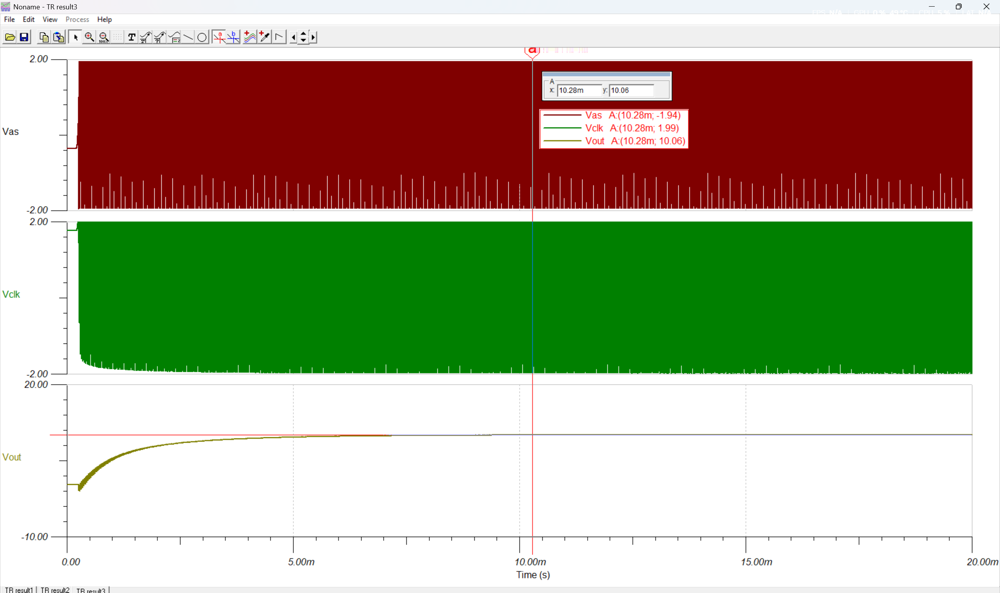
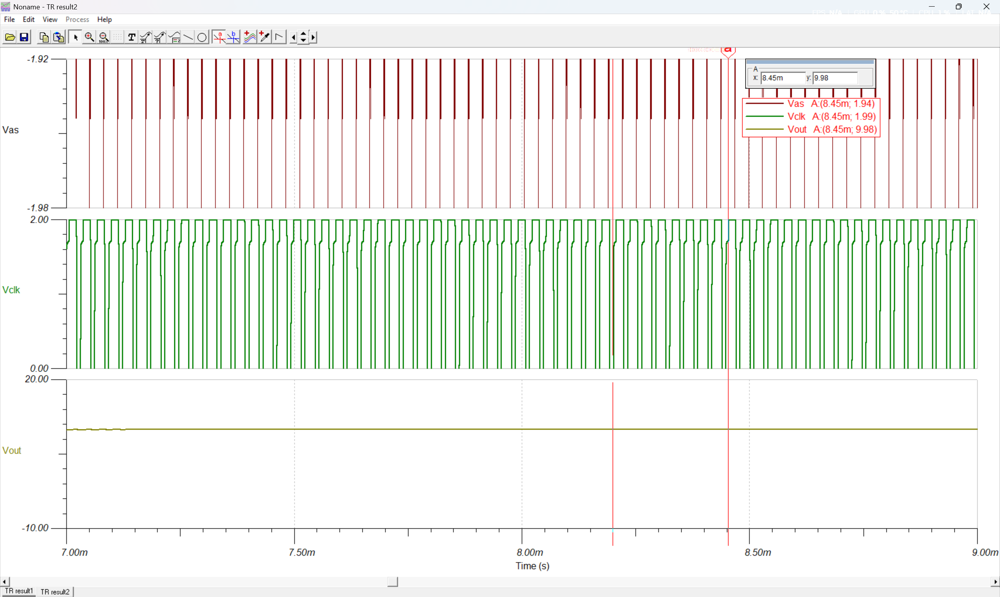

# DC-DC Voltage Multiplier (±2 V → 10 V)

University project: a positive DC-DC voltage multiplier that produces a 10 V
output from a ±2 V supply, designed for a minimum load of 200 kΩ.

## How it works
The circuit uses an on-board transistor oscillator and driver stage that feed a
diode-capacitor ladder, which multiplies the input voltage.

## Tools
- Schematic and PCB: OrCAD
- Simulation: TINA

## Simulation
Full transient simulation:

Zoom on the first 20 ms:

The output reaches 10 V in simulation. [Add what you observe: settling time,
ripple, behavior under load.]

## Files
- `DC-DC amplifier/` – OrCAD project (schematic)
- `Amplificator DC-DC(...).TSC` – TINA simulation file

## Status
- [x] Schematic (OrCAD)
- [x] Simulation (TINA)
- [ ] PCB layout
- [ ] Assembly and measurements
